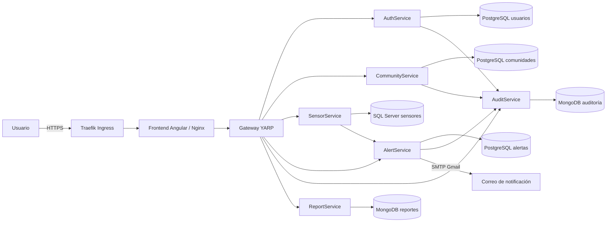
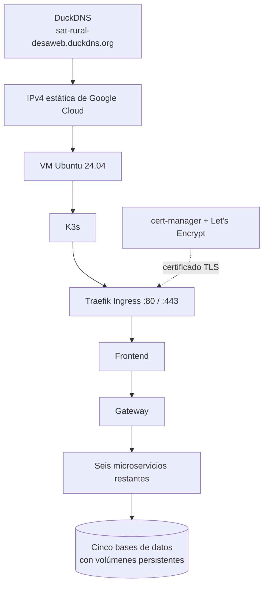

# SAT-Rural

Sistema web de monitoreo climático y alerta temprana para comunidades rurales. Permite consultar comunidades, sensores, lecturas, alertas y eventos; administrar reglas, atender alertas, revisar auditoría y generar reportes PDF. Incluye un simulador manual para demostrar escenarios climáticos.

## Aplicación publicada

- Sitio: [https://sat-rural-desaweb.duckdns.org](https://sat-rural-desaweb.duckdns.org)
- Cuenta administradora de demostración: `adminangi@gmail.com` (rol `ADMIN`). Usa la contraseña `adminangi123*`.
- Las alertas YELLOW, ORANGE y RED pueden enviar avisos por correo al activarse o escalar. El envío se configura mediante variables privadas en `.env`.

## Microservicios

| Servicio | Tecnología | Función |
| --- | --- | --- |
| Frontend | Angular 22, Tailwind CSS y Nginx | Panel web, administración y simulación |
| Gateway | ASP.NET Core 10 y YARP | Entrada API, validación JWT y enrutamiento |
| AuthService | NestJS y PostgreSQL | Usuarios, roles, JWT e inicio de sesión |
| CommunityService | ASP.NET Core 10 y PostgreSQL | Comunidades |
| SensorService | ASP.NET Core 10 y SQL Server | Sensores, lecturas, dashboard e ingreso de humedad |
| AlertService | Spring Boot 4 y PostgreSQL | Reglas, alertas, eventos y correo |
| AuditService | FastAPI y MongoDB | Bitácora y auditoría |
| ReportService | FastAPI y MongoDB | Generación e historial de PDF |



## Despliegue

La aplicación está desplegada en una VM de Google Cloud con K3s de un nodo. Kubernetes ejecuta los ocho servicios de aplicación, cinco bases de datos, almacenamiento persistente y Traefik. cert-manager obtiene y renueva el certificado TLS de Let's Encrypt; DuckDNS apunta el subdominio a la IPv4 estática de la VM. Solo el Ingress del frontend se publica en Internet; el Gateway y las bases permanecen dentro del clúster.



## Ingreso de lecturas de humedad

El endpoint público está disponible para lecturas de humedad con el sensor registrado `HUM-001`:

```http
POST https://sat-rural-desaweb.duckdns.org/api/sensors/readings
Content-Type: application/json
X-Device-Key: <clave configurada para el dispositivo>

{"sensorCode":"HUM-001","value":65}
```

La clave válida se define como `SENSOR_DEVICE_API_KEY` en `.env`; no debe incluirse en el código, README, capturas ni repositorio. El servicio valida la lectura, la guarda y la envía a evaluación de alertas.

## Simulación

La simulación global se inicia desde el Dashboard con **Ejecutar escenario** y se detiene con **Detener simulación**. En estado `NORMAL` no genera nuevas lecturas simuladas ni evaluaciones de alertas. Las lecturas históricas se conservan.

## Correo y acceso social

Para avisos por Gmail configura `GMAIL_USERNAME`, `GMAIL_APP_PASSWORD` y `ALERT_NOTIFICATIONS_RECIPIENTS` en `.env`. Se notifican activaciones o escalaciones de nivel; las lecturas repetidas que mantienen el mismo nivel no envían un correo nuevo.

El acceso con Google o GitHub requiere sus Client ID y Client Secret. No publiques valores de `.env`.

## Ejecutar en localhost

Requiere Docker Desktop con Docker Compose. Copia `.env.example` a `.env`, completa los valores privados y ejecuta desde la raíz:

```powershell
Copy-Item .env.example .env
docker compose config -q
docker compose up -d --build
docker compose ps
```

Abre `http://localhost:4200`. El Gateway local está en `http://localhost:8081`. Para revisar registros usa `docker compose logs --tail=80 gateway`. Para detener los contenedores sin borrar datos, ejecuta `docker compose down`; no uses `docker compose down -v` si deseas conservar las bases y los PDF.

## Verificación local

```powershell
Invoke-RestMethod http://localhost:8081/health
Invoke-RestMethod http://localhost:8081/api/reports/health
Invoke-RestMethod http://localhost:8084/health
Invoke-RestMethod http://localhost:8085/actuator/health
```

Las credenciales de Google/GitHub, claves de dispositivo, secretos JWT y contraseñas de base de datos son configuración privada y no deben guardarse en este archivo.
